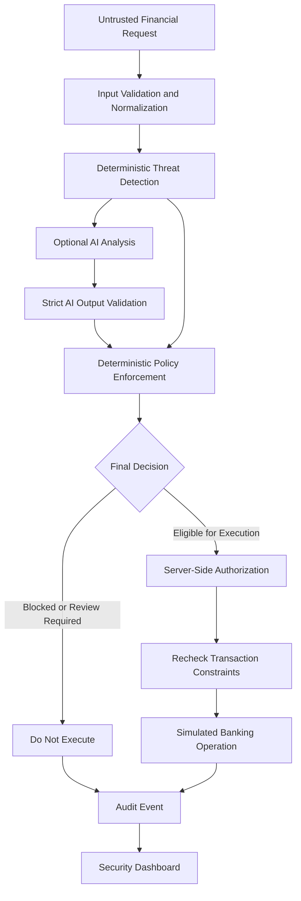

# FINIGUARD
### AI Security Firewall for Financial Transactions

**Intelligence analyzed. Every action verified.**

FINIGUARD is a defensive AI security gateway that analyzes untrusted financial requests, detects prompt injection and malicious instructions, and enforces deterministic security policies before simulated banking transactions can execute.

It combines explainable threat detection, optional AI-assisted analysis, deterministic policy enforcement, server-side transaction authorization, and correlated audit events in a single interactive security dashboard.

> **Hackathon challenge:** Bankism: Blue-Team AI Firewall & Guardrail Defense  
> **Product:** FINIGUARD

**Important:** FINIGUARD is a research and demonstration prototype. It uses synthetic account data and simulated transactions. It is not connected to real banking infrastructure and is not production-ready.

---

## The Problem

AI-enabled financial systems may process natural-language requests, payment descriptions, and other untrusted input. These inputs can contain malicious instructions that attempt to override system behavior, bypass security policies, or extract protected information.

A language model's assessment alone should not determine whether a financial operation executes.

FINIGUARD addresses this problem by separating **threat analysis, policy decisions, and transaction execution**.

## Our Approach

FINIGUARD follows three principles:

1. **Analyze first:** Normalize untrusted input and inspect it for suspicious instructions, obfuscation, and data-exfiltration attempts.
2. **Enforce deterministically:** Apply explicit validation, account checks, transfer limits, and security policies independently of AI recommendations.
3. **Verify every action:** Require server-side authorization before executing an eligible simulated transaction and record the resulting security events.

AI is optional and advisory. It cannot independently authorize a transfer or override a deterministic security block.

## Key Features

- **Layered threat detection:** Detects instruction overrides, role-play jailbreaks, malicious payment memos, obfuscation, policy bypass attempts, and protected-data requests.
- **AI-assisted analysis:** Supports an optional OpenAI-compatible chat-completions provider with strict output validation and bounded requests.
- **Deterministic policy engine:** Enforces transaction validation, account restrictions, transfer limits, available balances, and explicit transaction intent.
- **Server-side authorization:** Uses a single-use authorization capability bound to validated transaction details.
- **Fail-safe behavior:** Provider failures and malformed AI responses cannot bypass deterministic security controls.
- **Idempotency protection:** Prevents a repeated logical transfer request from executing a second time when the same idempotency key is reused.
- **Audit Explorer:** Displays correlated security events, request timelines, and bounded audit metadata without retaining raw request text in audit records.
- **Interactive dashboard:** Includes Overview, Request Inspector, Audit Explorer, Operations, and Evaluation views.
- **Evaluation framework:** Tests security decisions against synthetic fixtures and checks simulated transaction state for unexpected execution.

## Architecture



The AI analyzer supplies additional signals; it does not control the final authorization boundary. Deterministic rules remain authoritative, and transaction execution rechecks applicable constraints.

### Technology Stack

| Layer | Technologies |
|---|---|
| Frontend | React, Vite, JavaScript, CSS |
| Backend | Node.js, Express |
| API | REST endpoints with structured JSON responses |
| AI integration | Optional OpenAI-compatible chat-completions API |
| Security | Input normalization, threat detection, deterministic policy enforcement, server-side authorization |
| Audit | Bounded in-memory event store and request correlation |
| Testing | Node.js built-in test runner and synthetic evaluation fixtures |
| Version control | Git and GitHub |

## Security Decisions

FINIGUARD distinguishes among several outcomes:

| Outcome | Meaning |
|---|---|
| `APPROVED` | The request is eligible under the applicable policies. A transfer executes only when all required authorization checks succeed. |
| `BLOCKED` | A security rule prevents the requested operation. |
| `REVIEW_REQUIRED` | The request requires further review and does not execute. |
| `INVALID_REQUEST` | Required details or validation constraints are not satisfied. |

The structured verdict separates deterministic findings, AI analysis, policy decisions, and execution status.

A model's confidence score is treated as an uncalibrated model output—not as a probability that a request is safe.

## Running Locally

### Prerequisites

- Node.js 22.12 or newer
- npm 10 or newer

### 1. Clone the repository

```bash
git clone https://github.com/surajcmogaveera-ops/FINIGUARD.git
cd FINIGUARD
```

### 2. Install dependencies

```bash
npm ci
```

### 3. Start the backend

Open a terminal in the project root:

```bash
npm run dev:backend
```

The backend normally listens on `127.0.0.1:3001` during local development.

### 4. Start the frontend

Open a second terminal in the project root:

```bash
npm run dev:frontend
```

Open the local URL printed by Vite, typically `http://localhost:5173`.

During development, Vite proxies `/api` requests to the backend. When deploying the frontend and backend separately, configure the production API base URL and backend CORS settings for the deployed frontend origin.

## API Endpoints

The backend exposes the following versioned endpoints:

| Method | Endpoint | Purpose |
|---|---|---|
| `GET` | `/api/v1/health` | Check backend health and AI provider status |
| `POST` | `/api/v1/evaluate` | Analyze a natural-language request and optional transaction |
| `GET` | `/api/v1/audit` | Retrieve bounded audit metadata |
| `GET` | `/api/v1/audit/events` | Query security events with supported filters and pagination |
| `GET` | `/api/v1/audit/events/:eventId` | Retrieve a specific event |
| `GET` | `/api/v1/audit/requests/:requestId` | Inspect a correlated request timeline |
| `GET` | `/api/v1/observability` | Retrieve service counts derived from retained events |

### Example Request

```json
{
  "request": "Transfer INR 500 to Ananya.",
  "transaction": {
    "amount": 500,
    "currency": "INR",
    "recipient": "Ananya",
    "memo": "Lunch"
  }
}
```

Send this object to `POST /api/v1/evaluate` with `Content-Type: application/json`.

The response contains a structured security verdict. A successful transfer reports an execution status of `EXECUTED`; a blocked or review-required request must not execute.

## Demonstration Banking Policies

FINIGUARD uses a synthetic account registry and configurable demo constraints.

- Starting source balance: INR 25,000.
- Maximum transfer: INR 10,000.
- Maximum session debits: INR 20,000.
- Currency: INR.
- Self-transfers: prohibited.
- Unknown or mismatched accounts: rejected as invalid.
- The designated `Review Hold` recipient: requires review.

These values are demonstration settings, not real banking or regulatory requirements.

The ledger, account balances, audit events, and idempotency records are held in bounded in-memory stores. They reset when the backend restarts.

## Optional AI Analysis

AI analysis is disabled by default. The deterministic security path works without a live AI provider.

To configure an OpenAI-compatible provider locally:

1. Copy `.env.example` to `.env` in the project root.
2. Configure the supported `BANKISM_AI_*` settings.
3. Keep the API key on the backend only.
4. Restart the backend and check the health endpoint.

Never commit `.env` files or expose provider credentials in frontend variables, source code, screenshots, or logs.

The integration validates provider output against a strict schema. Provider failures fall back to deterministic-only policy, while suspicious or malformed AI output cannot independently authorize a transaction.

Automated tests and synthetic evaluations do not require a paid provider or send requests to a live AI service.

## Testing and Evaluation

Run the project checks from the root directory:

```bash
npm test
npm run evaluate
npm run lint
npm run build
```

The tests cover security detection, malformed input, AI failure behavior, authorization boundaries, transaction limits, idempotency, rollback behavior, audit consistency, and simulated account state.

### Latest Recorded Local Results

The latest reported local verification produced:

| Check | Result |
|---|---|
| Automated tests | 40 passed, 0 failed |
| Synthetic evaluation fixtures | 66 passed, 0 failed |
| Lint | Passed |
| Production frontend build | Succeeded |
| Unexpected executions in evaluation fixtures | 0 |

### Synthetic Detection Metrics

The latest evaluation reported these results on its included synthetic fixtures:

| Mode | Precision | Recall |
|---|---:|---:|
| Deterministic-only detection | 1.000 | 0.952 |
| AI-only, using valid mocked analyses | 0.333 | 0.333 |
| Combined deterministic and mocked AI/fallback | 0.913 | 1.000 |

These are results from a small, synthetic fixture set—not real-world attack-detection rates or a guarantee of security. The AI-only metrics use mocked analyses rather than a live provider. The combined mode also produced false positives in the included evaluation.

## Limitations and Future Work

FINIGUARD is a prototype, and its current limitations include:

- No integration with real banks or payment networks.
- No user authentication or role-based access control.
- No persistent database for account balances, ledger entries, or audit records.
- No guarantee of complete detection across languages, encodings, or adversarial inputs.
- No independent security certification or compliance validation.
- No verification of general live-provider response quality.

Potential future work includes persistent audit storage, authentication and access controls, broader adversarial evaluation, improved detection coverage, and deployment hardening.

## Project Structure

```text
FINIGUARD/
├── backend/
│   ├── evaluation/     # Synthetic security evaluation fixtures
│   ├── scripts/        # Supporting scripts
│   ├── src/
│   │   ├── ai/         # AI adapter and output validation
│   │   ├── audit/      # Audit event storage
│   │   ├── banking/    # Simulated accounts and transaction rules
│   │   ├── routes/     # Versioned API routes
│   │   ├── security/   # Detection, validation, policy and authorization
│   │   └── services/   # Request evaluation and idempotency
│   └── test/           # Automated tests
├── docs/               # Architecture and implementation documentation
├── frontend/
│   └── src/
│       ├── components/ # Dashboard views and reusable components
│       ├── api.js      # Frontend API integration
│       └── styles.css  # Dashboard styling
├── prompts/            # Versioned AI security-analysis prompts
├── package.json        # Root workspace scripts
└── README.md
```

## License

No license is specified in this repository. Unless a license is added, do not assume others have permission to redistribute or reuse the project.

---

**FINIGUARD — Intelligence analyzed. Every action verified.**

